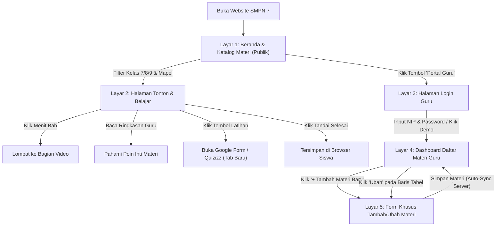

# Product Requirements Document (PRD) — Desain Ulang UI/UX di Google Stitch
**Nama Produk:** Repositori Video Pembelajaran Mandiri — UPTD SMP Negeri 7 Kota Tangerang Selatan  
**Mitra Pengembang:** Tim Pengabdian kepada Masyarakat (PkM) Teknik Informatika Universitas Pamulang  
**Target Platform:** Web Responsif (Desktop Laptop Guru/Lab & Layar HP Siswa)  
**Tujuan Dokumen:** Panduan spesifikasi fitur lengkap dan kumpulan *prompt* siap pakai untuk membuat desain antarmuka (UI) baru di **Google Stitch**.

---

## 1. Visi & Prinsip Utama Produk

Aplikasi ini dirancang dengan satu filosofi utama: **"Nol Hambatan untuk Siswa, Nol Kebingungan untuk Guru."**

1. **Siswa Langsung Belajar (100% Tanpa Login / Read-Only):**
   - Siswa tidak perlu membuat akun atau mengingat *password*. Begitu membuka situs, siswa langsung melihat katalog video berdasarkan Kelas (7, 8, 9) dan Mata Pelajaran.
   - Status *"Sudah Ditonton"* tersimpan secara otomatis di memori peramban (*browser*) HP atau laptop masing-masing siswa.
2. **Ramah Guru Senior (Non-Teknis):**
   - **Pemisahan Tampilan (Tidak Menumpuk):** Halaman Dashboard Guru hanya menampilkan daftar materi yang rapi. Ketika guru menekan tombol **`+ Tambah Materi Baru`**, layar berpindah ke halaman formulir khusus yang lega dan fokus.
   - **Tombol Berlabel Teks Jelas:** Tidak boleh ada tombol yang hanya berisi ikon misterius. Semua tombol wajib memiliki teks eksplisit (`+ Tambah Materi Baru`, `Lihat`, `Ubah`, `Hapus`).
   - **Penyimpanan Otomatis (Auto-Sync):** Tidak ada tombol teknis seperti *Backup JSON* atau *Restore*. Semua perubahan otomatis tersimpan ke server sekolah dengan indikator status yang menenangkan.

---

## 2. Peta Alur Pengguna (User Flow Diagram)



---

## 3. Arsitektur Fitur & Hak Akses

| Pengguna | Status Login | Hak Akses & Fitur Utama |
| :--- | :--- | :--- |
| **Siswa / Orang Tua / Tamu** | **Tanpa Login** *(Read-Only)* | • Mencari judul materi atau nama guru secara instan.<br>• Memfilter video berdasarkan **Kelas (Semua, Kelas 7, Kelas 8, Kelas 9)** dan **Mata Pelajaran**.<br>• Menonton video (YouTube Bebas Iklan atau Video Lokal Sekolah).<br>• Mengklik **Daftar Menit Penting (Bab)** untuk melompat ke menit tertentu.<br>• Membaca **Ringkasan / Catatan Inti Guru** di bawah video.<br>• Mengklik tombol **Kerjakan Latihan Soal** (menuju Google Form / Quizizz jika dilampirkan guru).<br>• Menekan tombol **Tandai Sudah Ditonton** (tersimpan lokal di perangkat siswa). |
| **Dewan Guru SMPN 7** | **Wajib Login** *(NIP/Email + Password atau Tombol Demo)* | • Melihat tabel daftar seluruh materi video yang sudah tayang beserta tanggal tayang dan sumbernya.<br>• Membuka halaman khusus **Tambah Materi Baru** yang terpisah dari tabel.<br>• Mengunggah video via **Tautan YouTube** (dengan fitur *Auto-Preview* thumbnail otomatis) atau **File Video Laptop (MP4)**.<br>• Mengisi informasi wajib (Judul, Kelas, Mapel) dan informasi opsional (Ringkasan, Menit Bab, Link Latihan Soal).<br>• Menyunting (*Ubah*) atau menghapus (*Hapus*) materi yang sudah ada.<br>• Melihat indikator **Tersimpan Otomatis di Server Sekolah**. |

---

## 4. Sistem Desain Visual (Design Tokens untuk Google Stitch)

Gunakan spesifikasi visual ini di Google Stitch agar tampilan terlihat resmi, hangat, bersih, dan nyaman bagi mata guru maupun siswa:

* **Gaya Visual:** *Clean Scholastic Editorial* (Bersih, terstruktur, tanpa gradasi neon berlebihan, tanpa efek *glassmorphism* yang mengganggu keterbacaan).
* **Palet Warna (Mode Terang - Utama):**
  * **Latar Belakang Utama (Canvas):** `#F8FAFC` (Putih keabuan lembut, tidak menyilaukan mata).
  * **Permukaan Kartu & Tabel (Surface):** `#FFFFFF` dengan garis tepi tipis `#E2E8F0`.
  * **Warna Utama (Primary Brand - Navy Sekolah):** `#122B5C` (Biru dongker resmi SMPN 7).
  * **Warna Aksen (Warm Scholastic Amber):** `#D97706` (Kuning keemasan hangat untuk penanda penting).
  * **Warna Status Sukses (Auto-Sync / Selesai):** `#15803D` (Hijau zamrud tenang).
  * **Warna Bahaya (Tombol Hapus / Keluar):** `#B91C1C` (Merah tegas).
* **Tipografi & Ukuran Teks (Ramah Guru Senior):**
  * **Font Judul:** *Plus Jakarta Sans* atau *Bricolage Grotesque* (Tegas, modern, mudah dibaca).
  * **Font Isi & Tabel:** *Plus Jakarta Sans* atau *Inter* dengan ukuran dasar minimal **`16px`** (hindari teks di bawah `13px` agar guru senior mudah membaca tanpa harus memperbesar layar).
  * **Tinggi Tombol (Touch Target):** Minimal **`44px–48px`** dengan jarak antar tombol yang lega agar tidak salah pencet.

---

## 5. Spesifikasi Detail 5 Layar Utama (Screen-by-Screen)

### Layar 1: Beranda & Katalog Materi (Tampilan Publik / Siswa)
1. **Header Navigasi Atas:**
   * Kiri: Logo SMPN 7 Tangerang Selatan + Nama Sekolah + Subjudul kecil *"Repositori Video Pembelajaran Mandiri"*.
   * Kanan: Tombol sakelar Mode Terang/Gelap + Tombol jelas **`Masuk Portal Guru`** (dengan ikon gembok/guru).
2. **Bagian Pembuka Ringkas (Compact Hero Banner):**
   * Judul singkat: *"Belajar Mandiri Kapan Saja, Bebas Distraksi."*
   * Tiga angka ringkasan kecil: Total Video Materi, Total Mata Pelajaran, dan Indikator Progres Siswa (*"X dari Y video sudah kamu tonton"*).
3. **Bilah Pencarian & Filter Besar (Sticky Filter Bar):**
   * Kolom pencarian lebar: *"Cari topik materi, rumus, atau nama guru..."*
   * Tombol Pil Kelas berukuran besar: `[ Semua Kelas ]` `[ Kelas 7 ]` `[ Kelas 8 ]` `[ Kelas 9 ]`
   * Dropdown / Pil Mata Pelajaran: *Semua Mapel, Matematika, IPA, Bahasa Indonesia, Bahasa Inggris, IPS, PPKn, Informatika*.
4. **Grid Kartu Video (3 Kolom di Desktop, 1 Kolom di HP):**
   * Setiap kartu menampilkan:
     * Gambar sampul (Thumbnail) 16:9 + Badge durasi di kanan bawah (`14:20`) + Badge *"✓ Sudah Ditonton"* di kiri atas jika siswa sudah menyelesaikan video.
     * Badge **Kelas** (misal: `Kelas 7`) & **Mata Pelajaran** (`Matematika`).
     * **Judul Materi** (maksimal 2 baris, tebal dan jelas).
     * **Nama Guru Pengampu** + **Tanggal Tayang** (misal: *Tri Elmania, S.Pd. • 21 Okt 2026*).
     * Indikator kecil di bagian bawah kartu jika materi memiliki *Ringkasan* atau *Latihan Soal*.

---

### Layar 2: Halaman Tonton & Belajar Siswa (Dedicated Watch View / Modal Lebar)
Saat siswa mengklik salah satu kartu video, tampilkan halaman/modal fokus belajar dengan tata letak 2 kolom di desktop (atau bertumpuk di HP):

1. **Kolom Utama Kiri (Area Video & Materi Inti - Lebar 70%):**
   * **Tombol Kembali:** `← Kembali ke Daftar Materi` di bagian paling atas.
   * **Pemutar Video 16:9:** Mendukung YouTube Bebas Iklan atau Pemutar Video Lokal HTML5.
   * **Baris Aksi Siswa (Di bawah video):**
     * Kiri: Judul Materi, Badge Kelas & Mapel, Nama Guru & NIP.
     * Kanan: Tombol besar **`✓ Tandai Sudah Ditonton`** (berubah warna menjadi hijau saat aktif).
   * **Kotak Tautan Latihan Soal (Hanya tampil jika guru mengisi link):**
     * Banner menonjol yang ramah siswa: *"Sudah paham materinya? Yuk uji pemahamanmu!"* disertai tombol **`📝 Kerjakan Latihan Soal (Google Form / Quizizz) ↗`**.
   * **Kotak Ringkasan / Catatan Inti Guru (Hanya tampil jika guru mengisi):**
     * Kartu bersih berlatar hangat yang menampilkan Capaian Pembelajaran (CP) dan poin-poin rangkuman materi yang ditulis oleh guru.
2. **Kolom Samping Kanan (Daftar Menit Penting / Bab - Lebar 30%):**
   * Judul: **Daftar Menit Penting (Bab Video)**
   * Daftar waktu yang bisa diklik langsung oleh siswa (contoh: `[00:00] Pengantar Materi`, `[03:15] Penjelasan Rumus`, `[07:30] Contoh Soal`).
   * *Aturan Adaptif:* Jika guru tidak mengisi daftar menit penting pada video tersebut, kolom kanan otomatis disembunyikan dan area video melebar penuh agar tidak ada ruang kosong yang sia-sia.

---

### Layar 3: Halaman Login Guru (Teacher Login View)
1. **Kartu Login terpusat yang bersih dan menenangkan:**
   * Logo Sekolah & Judul: *"Portal Pengelolaan Materi Guru"*
   * Subjudul: *"Khusus Bapak/Ibu Dewan Guru UPTD SMPN 7 Tangerang Selatan"*
   * Input 1: **NIP atau Email Guru** (dengan contoh *placeholder* yang jelas).
   * Input 2: **Kata Sandi** (dengan tombol *Lihat/Sembunyikan Sandi* agar guru tidak salah ketik).
   * Tombol Utama: **`Masuk ke Portal Guru`** (lebar penuh, warna Navy `#122B5C`).
2. **Kotak Akses Cepat Penguji / Demo PkM:**
   * Di bawah tombol login utama, terdapat kotak khusus berbingkai lembut: *"Mode Simulasi / Penguji PkM: Masuk langsung tanpa mengetik NIP"* dengan tombol **`⚡ Masuk Instan (Akun Guru Contoh)`**.

---

### Layar 4: Dashboard Utama Guru — Daftar Materi (Teacher Table View)
> [!IMPORTANT]
> Sesuai hasil diskusi, **jangan menggabungkan formulir unggah yang panjang dengan tabel daftar materi di satu layar yang sama**. Layar utama guru fokus 100% pada melihat dan mengelola daftar materi yang sudah ada.

1. **Bilah Profil Guru (Top Action Bar):**
   * Kiri: Foto/Inisial Guru + Nama Lengkap (*Tri Elmania, S.Pd.*) + NIP.
   * Tengah: Lencana Status Hijau: **`● Tersimpan Otomatis di Server Sekolah`**.
   * Kanan: Tombol **`Lihat Tampilan Siswa`** dan tombol **`Keluar (Logout)`**.
2. **Header Daftar Materi + Tombol Aksi Utama:**
   * Kiri: Judul *"Daftar Materi Video Pembelajaran"* + Pencarian cepat materi guru.
   * Kanan: Tombol besar dan sangat mencolok **`➕ Tambah Materi Video Baru`**.
3. **Tabel Materi yang Bersih & Mudah Dibaca:**
   * Kolom 1: **No**
   * Kolom 2: **Judul Materi & Mata Pelajaran** (Dilengkapi badge Kelas 7/8/9)
   * Kolom 3: **Kelengkapan** (Badge kecil penanda apakah ada *Ringkasan*, *Bab Menit*, atau *Link Soal*)
   * Kolom 4: **Tanggal Tayang & Sumber** (`YouTube` atau `Video Laptop`)
   * Kolom 5: **Tindakan (3 Tombol Berlabel Jelas):**
     * `[ ▶ Pratinjau ]` — Melihat tampilan video seperti yang dilihat siswa.
     * `[ ✏️ Ubah ]` — Membuka Layar 5 untuk mengedit materi.
     * `[ 🗑️ Hapus ]` — Memunculkan dialog konfirmasi sederhana sebelum menghapus.

---

### Layar 5: Halaman Khusus Tambah / Ubah Materi (Dedicated Teacher Form View)
Layar ini terbuka saat guru mengklik **`➕ Tambah Materi Video Baru`** atau **`✏️ Ubah`**. Dirancang dengan konsep **3 Langkah Berurutan (Step-by-Step Card)** agar guru yang kurang paham teknologi langsung mengerti urutannya:

* **Bagian Atas:** Tombol `← Batal & Kembali ke Daftar Materi` + Judul Halaman *"Tambah Materi Video Baru"*.

* **Kotak Langkah 1: Pilih Sumber Video (Wajib)**
  * Dua tombol pilihan besar (Tab): **`[ 🔗 Pakai Link YouTube ]`** atau **`[ 💻 Unggah File Video dari Laptop ]`**.
  * *Jika pilih Link YouTube:*
    * Kolom tempel URL YouTube.
    * **Fitur Auto-Preview:** Begitu link ditempel, langsung muncul kotak pratinjau gambar *thumbnail* YouTube di bawahnya dengan tulisan hijau *"✓ Video YouTube ditemukan dan siap digunakan"*. Ini sangat membantu guru memastikan link-nya tidak salah.
  * *Jika pilih File Laptop:*
    * Kotak besar *Drag & Drop* atau klik tombol **`Pilih File Video (MP4/WebM)`** dari komputer.

* **Kotak Langkah 2: Informasi Dasar Materi (Wajib)**
  * **Judul Materi Pembelajaran:** Input teks besar.
  * **Pilih Jenjang Kelas:** 3 tombol besar yang tinggal diklik: `( Kelas 7 )` `( Kelas 8 )` `( Kelas 9 )`.
  * **Pilih Mata Pelajaran:** Dropdown besar daftar mata pelajaran resmi SMPN 7.
  * **Durasi Video:** (Misal: `12:30` — terisi otomatis untuk file lokal atau bisa diketik singkat).

* **Kotak Langkah 3: Bahan Pendamping Belajar Siswa (100% Opsional — Bisa Dikosongkan)**
  * Diberi keterangan jelas dengan huruf ramah: *"Bagian di bawah ini TIDAK WAJIB. Isi hanya jika Bapak/Ibu ingin menambahkan rangkuman, menit bab, atau link latihan soal."*
  * **1. Ringkasan / Catatan Inti Guru (Opsional):** Kotak teks untuk menuliskan poin penting atau rumus.
  * **2. Tautan Latihan Soal / Kuis Eksternal (Opsional):** Kolom untuk menempelkan link *Google Form*, *Quizizz*, atau *Wordwall* jika guru punya kuis untuk video tersebut.
  * **3. Daftar Menit Penting / Bab Video (Opsional):** Kotak panduan singkat (contoh: `00:00 Pembukaan`, `03:20 Penjelasan Materi`).

* **Bilah Simpan di Bagian Bawah:**
  * Tombol Batal di kiri, dan tombol besar **`💾 Simpan & Tayangkan Materi ke Siswa`** di kanan.

---

## 6. Kumpulan Prompt Siap Pakai untuk Google Stitch

Salin (*copy-paste*) prompt di bawah ini langsung ke **Google Stitch** untuk men-generate desain masing-masing layar secara presisi:

### Prompt 1: Beranda & Katalog Siswa (Public Catalog View)
```text
Design a clean, accessible, distraction-free educational video repository web app for a public middle school ("SMP Negeri 7 Tangerang Selatan").
Style: Clean Scholastic Editorial, light mode (#F8FAFC background, #FFFFFF cards, #122B5C deep navy primary, #D97706 warm amber accents, 1px solid #E2E8F0 borders, no gradients, no glassmorphism, minimum 16px body text).

Layout Structure:
1. Top Navbar: School crest logo + "SMP NEGERI 7 TANGERANG SELATAN - Repositori Video Pembelajaran Mandiri" on the left. Theme toggle and a clear button "Masuk Portal Guru" on the right.
2. Compact Hero Banner: Headline "Belajar Mandiri Kapan Saja, Bebas Distraksi", subtext for students (no login required), and 3 clean stat pills ("7 Materi Tersedia", "7 Mata Pelajaran", "Progres Belajar Lokal").
3. Sticky Filter Bar: Large search input ("Cari judul materi, topik, atau nama guru..."), segmented grade buttons ("Semua Kelas", "Kelas 7", "Kelas 8", "Kelas 9"), and a Subject dropdown ("Semua Mata Pelajaran", "Matematika", "IPA", "Bahasa Inggris", etc.).
4. Video Card Grid (3 columns): Each card has a 16:9 thumbnail with a duration badge ("14:20") and an optional green "✓ Sudah Ditonton" badge, Grade & Subject pills, bold 2-line title, Teacher name with publication date ("Tri Elmania, S.Pd. • 21 Okt 2026"), and subtle tags showing if Summary Notes or Practice Quiz is included.
```

### Prompt 2: Halaman Tonton & Belajar Siswa (Student Watch & Study View)
```text
Design a distraction-free Student Video Watch & Study Page for middle school students ("SMP Negeri 7 Tangerang Selatan"). No student login required.
Style: Clean Scholastic Editorial (#F8FAFC background, #FFFFFF surface cards, #122B5C navy primary, #15803D green success).

Layout Structure:
1. Top bar with a clear back button "← Kembali ke Katalog Materi".
2. Two-column main layout (70% left, 30% right):
   - Left Column (70%):
     a) 16:9 Video Player frame with clean playback controls.
     b) Title bar below video with Grade badge ("Kelas 7"), Subject badge ("Matematika"), Teacher info ("Tri Elmania, S.Pd."), and a prominent toggle button "✓ Tandai Sudah Ditonton".
     c) Highlighted Callout Card for External Practice Quiz: "Sudah paham materinya? Uji pemahamanmu sekarang" with a primary action button "📝 Kerjakan Latihan Soal (Google Form)".
     d) Teacher's Study Summary Card ("Ringkasan & Catatan Inti Guru"): Clean, well-spaced reading card displaying Learning Outcomes (Capaian Pembelajaran) and numbered key takeaway points.
   - Right Column (30%):
     a) "Daftar Menit Penting (Bab Video)" card with clickable timestamp rows (e.g., "00:00 Pengantar Materi", "02:30 Pengertian Variabel & Koefisien", "06:15 Contoh Soal Aljabar") where the active chapter is highlighted.
```

### Prompt 3: Dashboard Utama Guru — Tabel Materi (Senior-Teacher-Friendly Dashboard)
```text
Design an ultra-simple, senior-teacher-friendly CMS Dashboard for middle school teachers ("Portal Dewan Guru SMPN 7 Tangerang Selatan"). Designed specifically so non-tech-savvy older teachers can use it effortlessly.
Style: High-contrast Clean Scholastic UI (#F8FAFC canvas, #FFFFFF card, #122B5C navy, large 16px+ typography, all buttons must have clear Indonesian text labels—no icon-only buttons).

Layout Structure:
1. Top Teacher Profile Bar: Teacher avatar initials ("TR"), Name ("Tri Elmania, S.Pd."), NIP number, a reassuring green live status pill ("● Tersimpan Otomatis di Server Sekolah"), a button "Lihat Halaman Siswa", and a red outline button "Keluar (Logout)".
2. Main Content Card Header: Title "Daftar Materi Pembelajaran di Repositori", search bar to filter table, and a large prominent primary button "+ Tambah Materi Video Baru" on the top right.
3. Clean Data Table with 5 columns:
   - No
   - Judul & Mata Pelajaran (with Kelas 7/8/9 pill)
   - Kelengkapan Materi (pills indicating "Ada Ringkasan", "5 Bab Menit", "Ada Link Latihan")
   - Tanggal Tayang & Sumber ("Rabu, 21 Okt 2026 • YouTube")
   - Tindakan: 3 explicit labeled buttons per row: "[ ▶ Tonton ]", "[ ✏️ Ubah ]", and "[ 🗑️ Hapus ]".
```

### Prompt 4: Halaman Khusus Form Tambah / Ubah Materi Guru (Step-by-Step Editor)
```text
Design a dedicated, step-by-step "Add / Edit Educational Video" form page for non-tech-savvy middle school teachers ("Tambah Materi Video Baru - SMPN 7 Tangerang Selatan").
Style: Calm, spacious, single-column centered layout (max-width 800px) broken into 3 clear numbered step cards so teachers never feel overwhelmed.

Layout Structure:
1. Top Header: Back button "← Batal & Kembali ke Daftar Materi" and page title "Tambah Materi Video Baru".
2. Step Card 1 — "Langkah 1: Pilih Sumber Video (Wajib)":
   - Two large radio tabs: "🔗 Tautan Video YouTube" (active) and "💻 Unggah File Video dari Laptop".
   - URL input field with a pasted YouTube link.
   - Automatic YouTube Preview Box below the input showing the video thumbnail image, video title, and a green confirmation message "✓ Video YouTube valid dan siap ditayangkan".
3. Step Card 2 — "Langkah 2: Informasi Dasar Materi (Wajib)":
   - Large text input for "Judul Materi Pembelajaran *".
   - Large 3-button selector for "Pilih Jenjang Kelas *": [ Kelas 7 ] [ Kelas 8 ] [ Kelas 9 ].
   - Large dropdown for "Mata Pelajaran *" and short input for "Perkiraan Durasi (Menit:Detik)".
4. Step Card 3 — "Langkah 3: Bahan Pendamping Belajar (Opsional - Boleh Dikosongkan)":
   - Friendly helper banner: "Bagian ini opsional. Kosongkan saja jika Bapak/Ibu hanya ingin menayangkan video."
   - Textarea for "Ringkasan / Catatan Inti Guru untuk Siswa (Opsional)".
   - URL input for "Tautan Latihan Soal Google Form / Quizizz (Opsional)".
   - Textarea for "Daftar Menit Penting / Bab Video (Opsional - satu baris per menit)".
5. Bottom Sticky Action Footer: "Batal" button on the left, and a large primary button "💾 Simpan & Tayangkan Materi ke Siswa" on the right.
```

